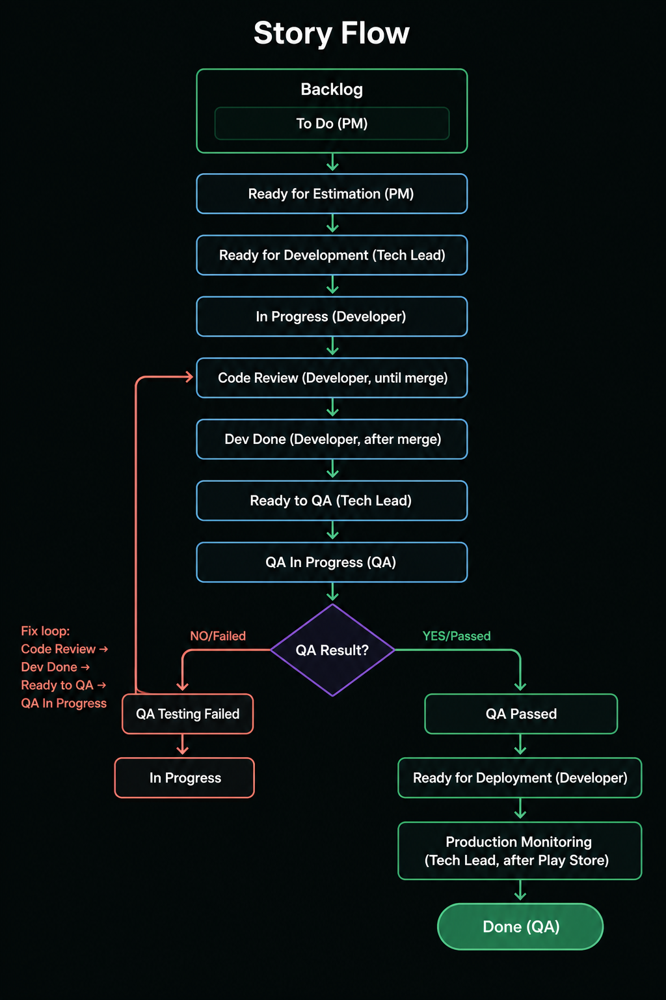
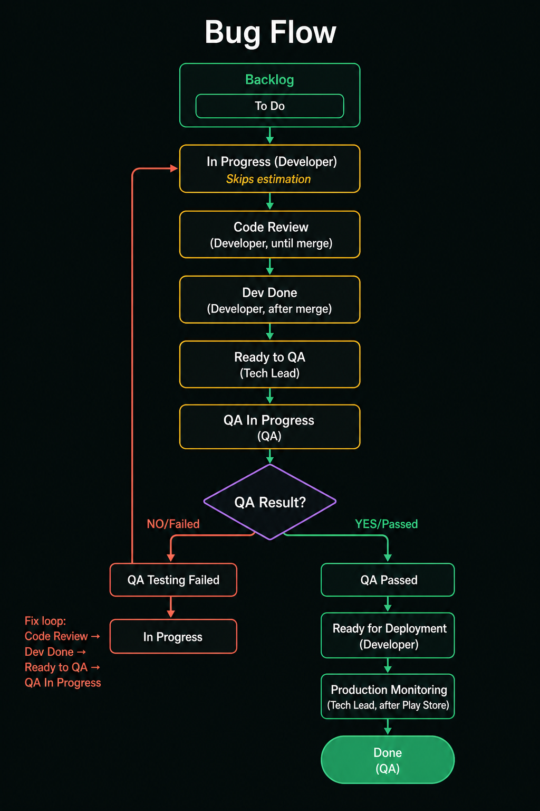

# Jira Development Workflow

Standard delivery workflow for **Story** and **Bug** work.

Interactive flowchart: [flowchart.html](flowchart.html)

## Flow images





## Issue types

Only two types:

- **Story** — planned product/feature work
- **Bug** — defect fix

All tickets start in the **Backlog** with status **To Do**.

## Roles

| Role | Owns |
|---|---|
| PM (Project / Product Manager) | To Do, Ready for Estimation |
| Tech Lead | Ready for Development, Ready to QA, Production Monitoring (after Play Store) |
| Developer | In Progress, Code Review, Dev Done, Ready for Deployment |
| QA Lead / QA members | QA In Progress, QA Passed, QA Testing Failed, Done |

## Story path

```text
Backlog
  └─ To Do
       └─ Ready for Estimation          (PM)
            └─ Ready for Development    (Tech Lead)
                 └─ In Progress         (Developer)
                      └─ Code Review    (Developer — stays until PR merged)
                           └─ Dev Done  (Developer — after merge)
                                └─ Ready to QA              (Tech Lead)
                                     └─ QA In Progress      (QA)
                                          ├─ QA Passed
                                          │    └─ Ready for Deployment      (Developer)
                                          │         └─ Production Monitoring (Tech Lead after Play Store)
                                          │              └─ Done             (QA)
                                          └─ QA Testing Failed
                                               └─ In Progress → Code Review → Dev Done → Ready to QA → QA In Progress (loop)
```

## Bug path

Bugs also start as **To Do** in the Backlog, then skip estimation:

```text
Backlog
  └─ To Do
       └─ In Progress                   (Developer — skip Ready for Estimation / Ready for Development)
            └─ Code Review
                 └─ Dev Done
                      └─ Ready to QA              (Tech Lead)
                           └─ QA In Progress      (QA)
                                ├─ QA Passed → Ready for Deployment → Production Monitoring → Done
                                └─ QA Testing Failed → In Progress → … (same fix loop)
```

## Status rules

| Status | Who moves it | Notes |
|---|---|---|
| To Do | PM | Lives in Backlog |
| Ready for Estimation | PM | Story only |
| Ready for Development | Tech Lead | Story only |
| In Progress | Developer | Coding |
| Code Review | Developer | Stay here until PR is merged (even if review requests changes) |
| Dev Done | Developer | Set only after merge |
| Ready to QA | Tech Lead | Handoff gate before QA starts |
| QA In Progress | QA Lead / QA | Testing in progress |
| QA Passed | QA | Happy path |
| QA Testing Failed | QA | Triggers fix loop |
| Ready for Deployment | Developer | After QA Passed |
| Production Monitoring | Tech Lead | After Play Store deploy |
| Done | QA | Final close; sprint item complete only after this |

## Code review rule

Do **not** move back to In Progress when review fails.

Keep status as **Code Review** through all review rounds. Move to **Dev Done** only when the PR is **merged**.

## QA fail loop

1. QA → **QA Testing Failed**
2. Developer → **In Progress**
3. Developer → **Code Review** (until merge)
4. Developer → **Dev Done**
5. Tech Lead → **Ready to QA**
6. QA → **QA In Progress** again

## Release completion

A sprint item is complete only when QA marks **Done** after Tech Lead finishes **Production Monitoring** on the Play Store release.

## Quick compare

| Step | Story | Bug |
|---|---|---|
| Backlog / To Do | Yes | Yes |
| Ready for Estimation | Yes | No |
| Ready for Development | Yes | No |
| In Progress → Done path | Yes | Yes (same from In Progress onward) |
